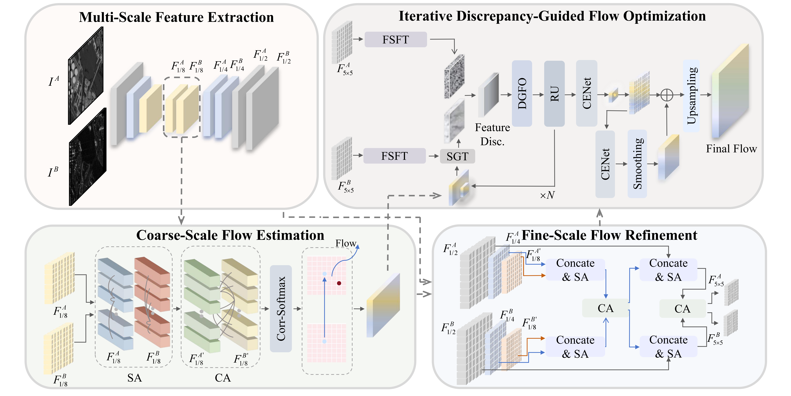

# CRFT (CVPR 2026)

### [Project Page](https://github.com/NEU-Liuxuecong/CRFT)

Official implementation of **CRFT: Consistent-Recurrent Feature Flow Transformer for Cross-Modal Image Registration**.

## Links
- **Code**: [GitHub Repository](https://github.com/NEU-Liuxuecong/CRFT)
- **Paper**: [arXiv](https://arxiv.org/abs/2604.05689)

## Authors

**Xuecong Liu, Mengzhu Ding, Zixuan Sun, Zhang Li, Xichao Teng**

## Overview



## Code Update (October 2026)

We have updated the CRFT implementation to improve its usability and facilitate further research.

**Resolution Clarification.** In the original CVPR 2026 paper, experiments involving 512 × 512 images were conducted at a downsampled resolution of 64 × 64 due to GPU memory limitations, as explicitly stated in the paper.

The repository has now been updated with a revised implementation. Please note that the experimental settings used in the original paper and those supported by the updated implementation may differ.

For reproducibility, researchers should carefully check the corresponding configurations, input resolutions, and pretrained checkpoints when evaluating CRFT.

We will continue to maintain this repository and welcome feedback from the research community.

## Data Preparation

To evaluate/train CRFT, you will need to download the required datasets.

* [RoadScene](https://pan.baidu.com/s/1MLmwlUf2jdWdWSVQwwQt2w?pwd=kr84)
* [OSdataset](https://pan.baidu.com/s/1C-YckJJvCNULfpMQxy_yfA?pwd=mj8d)

You can create symbolic links to wherever the datasets were downloaded in the `datasets` folder.

```text
datasets/
├── os_dataset/
│   ├── train/
│   │   ├── image_pair/
│   │   ├── truth_flow/
│   │   └── datum/
│   ├── test/
│   │   ├── image_pair/
│   │   ├── truth_flow/
│   │   └── datum/
│   └── val/
│       ├── image_pair/
│       ├── truth_flow/
│       └── datum/
└── RoadScene/
    ├── train/
    │   ├── image_pair/
    │   ├── truth_flow/
    │   └── datum/
    ├── test/
    │   ├── image_pair/
    │   ├── truth_flow/
    │   └── datum/
    └── val/
        ├── image_pair/
        ├── truth_flow/
        └── datum/
```

## Requirements

```shell
conda create --name crft python=3.9.7
conda activate crft

conda install pytorch=2.3.1 torchvision=0.18.1 pytorch-cuda=12.1 matplotlib tensorboard scipy opencv -c pytorch -c nvidia

pip install opencv-python==4.8.0.76
pip install numpy==1.26.4
pip install pytorch-lightning loguru joblib tqdm h5py einops
```

## Training

```shell
python train.py
```

## Models

We provide models trained on OSdataset and RoadScene, respectively.

The default checkpoint paths for evaluation are:

```text
checkpoints/
├── CRFT_OSdataset.ckpt
└── CRFT_RoadScene.ckpt
```

## Test

```shell
python test.py
```

Please ensure that the input resolution, model configuration, and checkpoint are compatible with the selected evaluation settings.

## Citation

If you find our work useful in your research, please consider citing:

```bibtex
@inproceedings{liu2026crft,
  title={CRFT: Consistent-Recurrent Feature Flow Transformer for Cross-Modal Image Registration},
  author={Liu, Xuecong and Ding, Mengzhu and Sun, Zixuan and Li, Zhang and Teng, Xichao},
  booktitle={Proceedings of the IEEE/CVF Conference on Computer Vision and Pattern Recognition},
  pages={34784--34794},
  year={2026}
}
```
